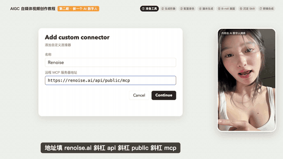
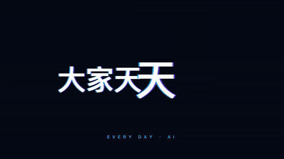
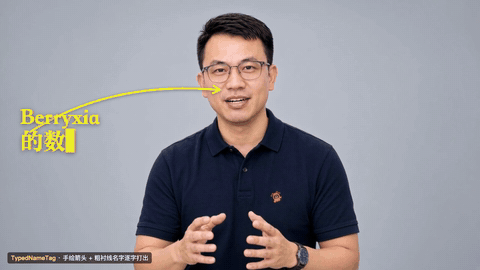
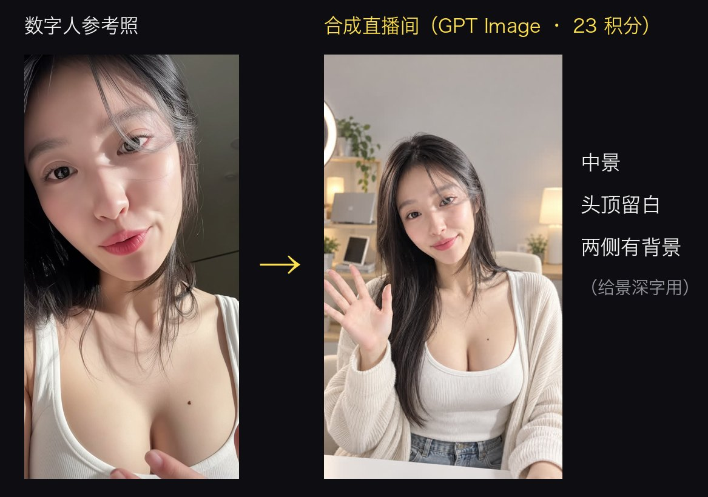
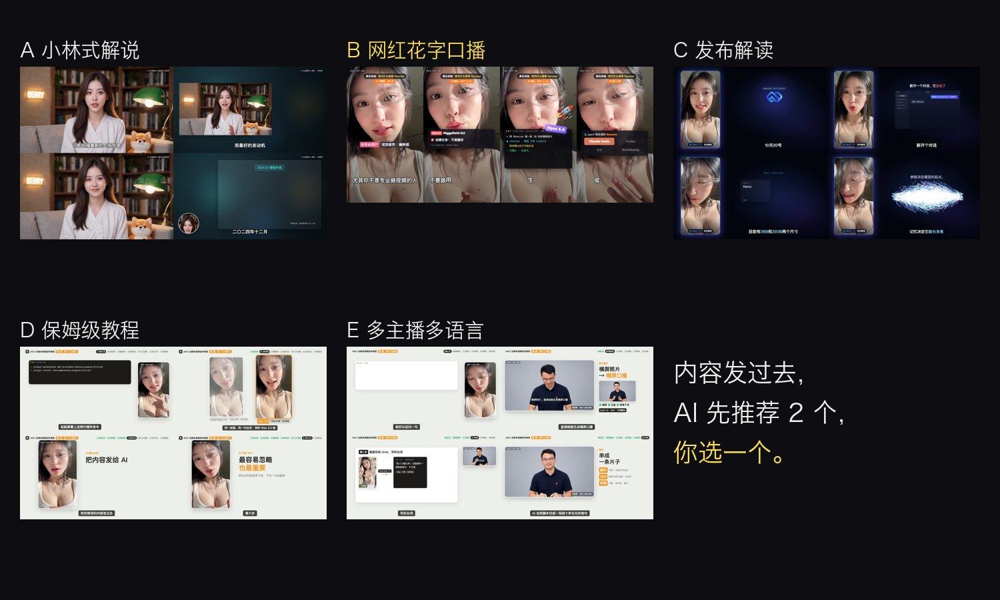
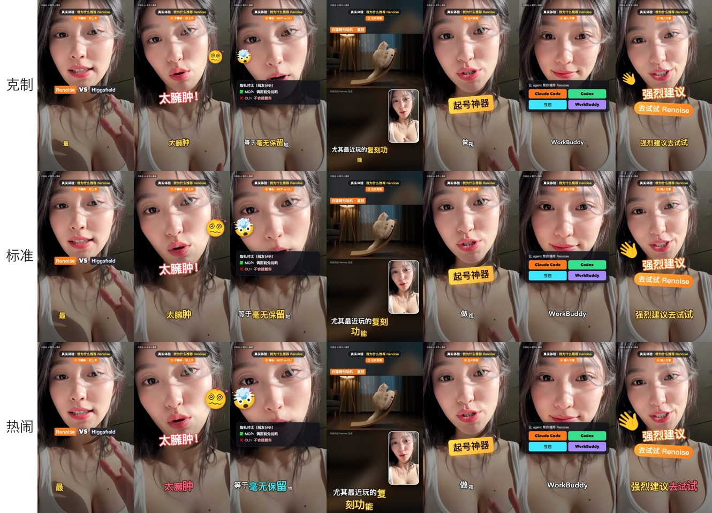
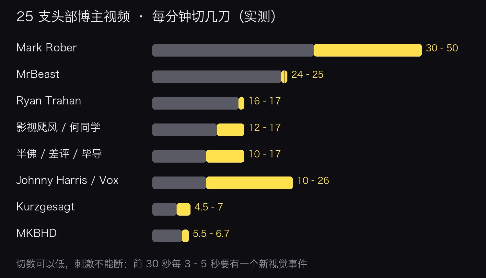
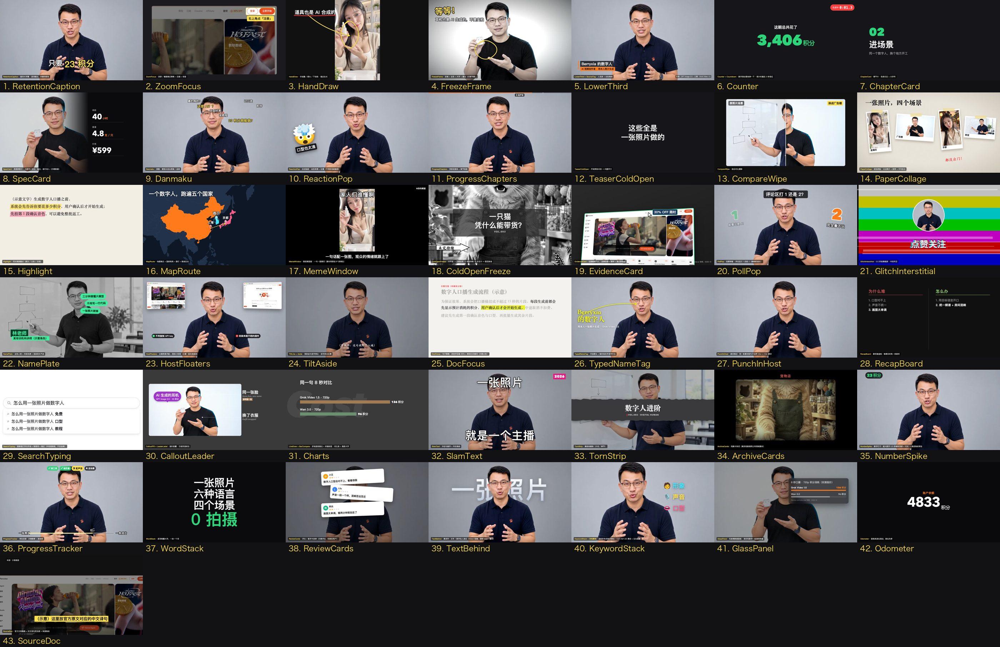
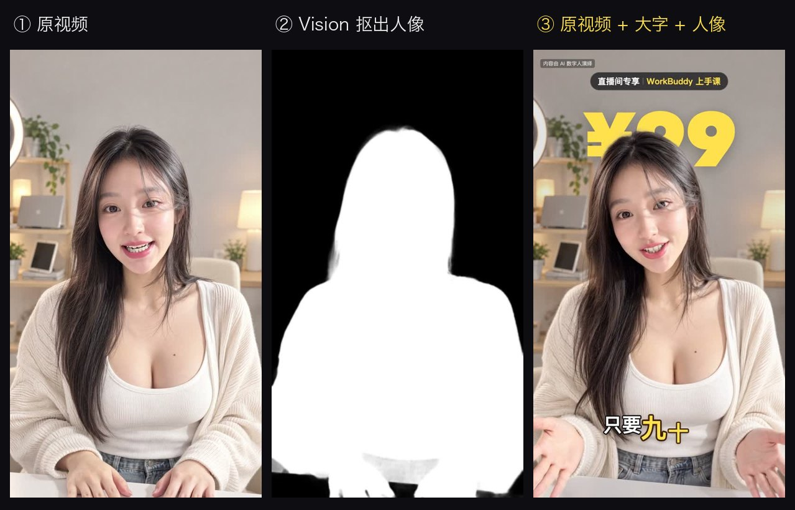
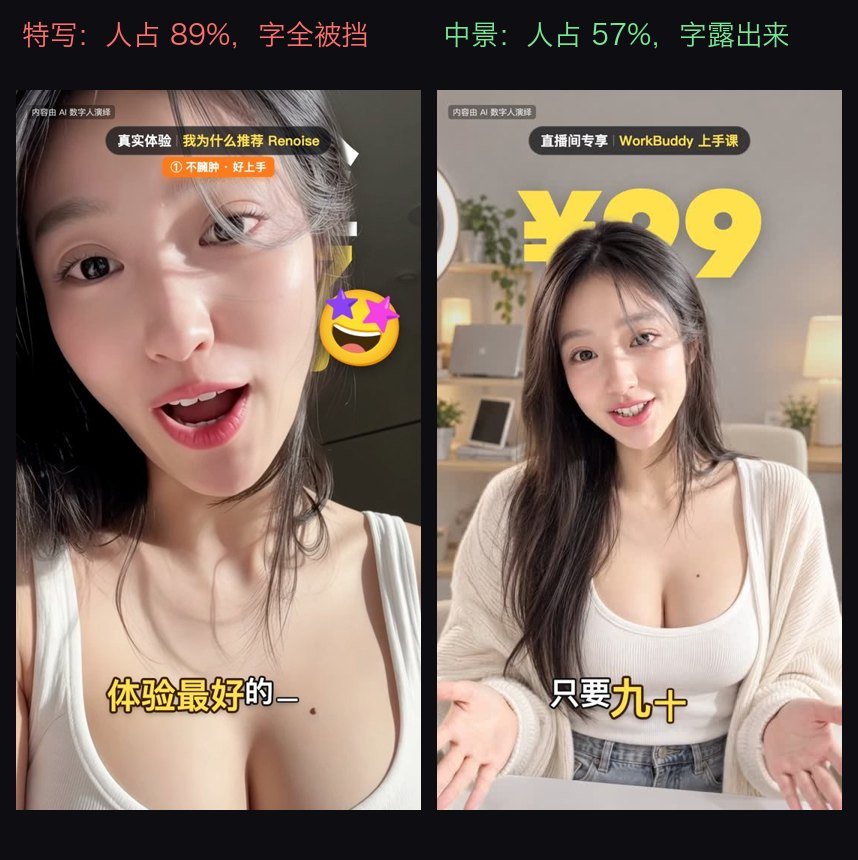

<div align="center">

# Digital Human Koubo · AI 数字人口播

**一张照片 + 一句话 → 一条带数字人出镜的口播成片。**
写稿、对口型的 AI 主播、修音、字幕、头部博主级包装，全部交给你的 AI Agent 自动完成。

**简体中文** · [English](README.en.md)

[](LICENSE)

[](https://jimeng.jianying.com)


</div>

> 这条 27 秒的直播间广告里，主播不存在。脸、声音、直播间、花字、价格动画，全是 AI 做的。
> 输入只有一句话：「用这个数字人做一条 30 秒直播间广告，卖 WorkBuddy 上手课，10 节课 99 元，原价 999。」
> 迁移到即梦通道后，同样一条片子只需 **约 170 即梦积分**（每日可领）；我们实测跑通的第一条完整成片——90 秒财经解说——口播部分只花了 330 积分。

---

## 示例

点 GIF 或「播放」看完整视频。下面每一条都是用这个仓库做出来的。

| | | |
|:---:|:---:|:---:|
| <a href="https://github.com/andyhuo520/digital-human-koubo/releases/download/v1.0.0/workbuddy-live-ad.mp4"></a> | <a href="https://github.com/andyhuo520/digital-human-koubo/releases/download/v1.0.0/renoise-koubo-huazi.mp4"></a> | <a href="https://github.com/andyhuo520/digital-human-koubo/releases/download/v1.0.0/text-behind.mp4"></a> |
| **直播间带货广告** · 9:16 · 27 秒<br>风格 B + 景深价格 ¥999→¥99<br>[▶ 播放](https://github.com/andyhuo520/digital-human-koubo/releases/download/v1.0.0/workbuddy-live-ad.mp4) | **产品推荐口播** · 9:16 · 89 秒<br>花字、动态表情、画中画<br>[▶ 播放](https://github.com/andyhuo520/digital-human-koubo/releases/download/v1.0.0/renoise-koubo-huazi.mp4) | **文字在人身后（景深字）** · 5 秒<br>Vision 人像抠图，三层合成<br>[▶ 播放](https://github.com/andyhuo520/digital-human-koubo/releases/download/v1.0.0/text-behind.mp4) |

| | |
|:---:|:---:|
| <a href="https://github.com/andyhuo520/digital-human-koubo/releases/download/v1.0.0/tutorial-ep2.mp4"></a> | <a href="https://github.com/andyhuo520/digital-human-koubo/releases/download/v1.0.0/tutorial-digital-human-upgrade.mp4"></a> |
| **保姆级教程** · 16:9 · 4 分 36 秒<br>数字人亲自讲「我是怎么被做出来的」（风格 D）<br>[▶ 播放](https://github.com/andyhuo520/digital-human-koubo/releases/download/v1.0.0/tutorial-ep2.mp4) | **数字人升级版** · 16:9 · 5 分 55 秒<br>两位主播、六种语言、四个场景、猫狗角色（风格 E）<br>[▶ 播放](https://github.com/andyhuo520/digital-human-koubo/releases/download/v1.0.0/tutorial-digital-human-upgrade.mp4) |
| <a href="https://github.com/andyhuo520/digital-human-koubo/releases/download/v1.0.0/memt-launch.mp4"></a> | <a href="https://github.com/andyhuo520/digital-human-koubo/releases/download/v1.0.0/xiaolin-style-explainer.mp4"></a> |
| **发布解读** · 16:9 · 39 秒<br>主播在侧边，右侧代码动效（风格 C）<br>[▶ 播放](https://github.com/andyhuo520/digital-human-koubo/releases/download/v1.0.0/memt-launch.mp4) | **财经 / 科技解说** · 16:9 · 2 分 21 秒<br>图表、文件标黄、章节卡（风格 A）<br>[▶ 播放](https://github.com/andyhuo520/digital-human-koubo/releases/download/v1.0.0/xiaolin-style-explainer.mp4) |

<div align="center">
<a href="https://github.com/andyhuo520/digital-human-koubo/releases/download/v1.0.0/packaging-gallery.mp4"></a><br>
<b>包装组件图鉴</b> · 48 个组件 · 2 分 40 秒 · <a href="https://github.com/andyhuo520/digital-human-koubo/releases/download/v1.0.0/packaging-gallery.mp4">▶ 播放</a>
</div>

> 示例里的主播全部是 AI 数字人，每条片子都标了「内容由 AI 数字人演绎」。男主播是作者用本人照片做的数字分身。

---

## 能做什么

- **一张照片做出固定的数字人**：脸、服装、声音描述、提示词模板都存在 `persona.json`，每条片子都是同一个人。想进什么场景（直播间、门店、教室、书房），先用即梦图片合成定妆照/开场画面，再让她开口。
- **对口型的口播片段**：稿子切段后走**即梦官方 dreamina CLI**——`seedance2.0mini` 两种玩法：把台词写进提示词让模型原生配音（口型天然同步），或用你自录/TTS 的音频作参考做音频驱动口型（口型跟最终声音逐字同步，成片零换声）。长段/精修用 `seedance2.5`（单次最长 30 秒，VIP）。
- **先报价，再花钱**：所有生成脚本默认干跑——先报「段数 · 秒数 · 积分 · 余额」，你点头加 `--yes` 才提交；先拍第 1 段给你看，满意再批量。
- **两道质检**：每段用 `apiz align` 把生成语音和文稿逐字比对（实测零错字，同时产出字级打轴数据），再抽帧检查（Seedance 偶尔也会自己烧字幕，有就重拍那段）。本地 whisper 仍可用（零积分可选）。
- **声音统一**：固定角色参考图（Seedance 会从脸推声音）+ 固定音色描述 + 1/3 倍频程频谱匹配与去齿音（`voicefx/unify.py`，实测齿音段间差 13.2 dB → 5.9 dB），30 段分开生成的口播听起来像一次录完。
- **按内容推荐剪辑风格**：Agent 先诊断内容，推荐 2 种风格并附预览图，一次问完（风格 · 比例时长 · 花字强度 · 主播）。
- **48 个包装组件**：逐帧拆了 25 支头部博主视频（MrBeast、Mark Rober、Ryan Trahan、MKBHD、影视飓风、何同学、Johnny Harris、Vox、Kurzgesagt、回形针、半佛仙人、差评、毕导）。每种风格自带默认包装，想加减直接说。
- **景深字**：大字 / 数字放在背景和人之间（macOS Vision 人像分割 → 透明视频 → 三层合成）。
- **多语言**：英、日、韩、法、西、阿拉伯语实测；旁白与指定音色走 edge-tts（免费），克隆声走 apiz。
- **多种 Agent 都能用**：标准 `SKILL.md` Agent Skill + 脚本。**不再需要接任何 MCP 服务器**——只要能装 Skill、能在本机跑命令（即梦 CLI / ffmpeg / Python / Node），就能驱动整条流程。

## 工作流程

```
你的内容 ──► 0. 环境检查（即梦 dreamina CLI / apiz / ffmpeg，已经有的直接跳过）
              1. 诊断内容 → 5 种风格里推荐 2 种 → 一次问完 → brief.json
              2. 写稿 script.json（每段 ≤15 秒，中文约 5.4 字/秒）
              3. build_plan 报价 → 等你确认 → 先拍第 1 段 → 你看过 → 批量
              4. 生成（即梦）→ 下载校验 → apiz align 回听 → 抽帧检查
              5. 声音统一（频谱匹配 + 去齿音 + 同一房间混响）
              6. 逐字时间轴（tl.json）
              7. Remotion 剪辑：风格模板 + 默认包装（+ 你点名的手法）
              8. 渲染 → 看过渡中间帧 → 响度（-14 / -16 LUFS）
```

<p align="center"></p>

---

## 支持哪些 Agent

这个 Skill 是一个带 `SKILL.md`（开放的 Agent Skills 格式）的文件夹，加上 Python / Shell / Remotion 脚本。要跑通**完整**流程，Agent 只需要两样能力：

1. **能装 Agent Skills**（技能目录或上传技能包）；
2. **能在你电脑上执行命令**（即梦 dreamina CLI、apiz CLI、ffmpeg、Python、Node——用来生成、质检、剪辑）。

生成走你自己的即梦账号（OAuth 浏览器登录，不复制任何 key），**不再需要接远程 MCP 服务器**。

| Agent | 装 Skill | 本机执行命令 | 状态 |
|---|---|---|---|
| **Claude Code** | `~/.claude/skills/` | ✅ | ✅ 已实测，这个仓库就是用它做的 |
| **Codex**（CLI / 桌面） | `~/.codex/skills/` | ✅ | ✅ 预期可用（同一套脚本） |
| **OpenClaw** | 放进 OpenClaw 的技能目录（见其文档） | ✅ | ⚙️ 应可用 |
| **WorkBuddy** | 技能 → 导入文件夹 / 压缩包 | ✅ 桌面端 Agent | ⚙️ 应可用，菜单名以 App 当前版本为准 |
| **豆包** · **千问办公** · **纳米Work** 等 Agent 产品 | 产品支持 Agent Skills 就导入 | 剪辑需要 | ⚙️ 满足两样能力即可，具体入口以各产品文档为准 |
| **Claude 桌面端 / claude.ai** | 设置里上传技能包 | ⚠️ 只有沙盒 | 写稿、设计场景、报价能做；本机生成与剪辑需要能跑命令的 Agent |

> 如果你的 Agent 只能聊天、不能跑本机命令，也可以先用它**写稿和设计拍表**；生成与剪辑交给 Claude Code / Codex，或照 [`SKILL.md`](skills/digital-human-koubo/SKILL.md) 里的命令手动跑。

---

## 安装

### 1 · 下载代码

```bash
git clone https://github.com/andyhuo520/digital-human-koubo.git
cd digital-human-koubo
```

### 2 · 把两个 Skill 装进你的 Agent

仓库里有两个 Skill：`digital-human-koubo`（主 Skill）和 `finance-explainer`（风格 A「财经 / 科技解说」的引擎）。

**Claude Code**
```bash
mkdir -p ~/.claude/skills && cp -R skills/digital-human-koubo skills/finance-explainer ~/.claude/skills/
```
**Codex**
```bash
mkdir -p ~/.codex/skills && cp -R skills/digital-human-koubo skills/finance-explainer ~/.codex/skills/
```
**WorkBuddy / OpenClaw / 其他 Agent**：把两个文件夹打成压缩包，在产品的「技能」页面导入，或者复制进它的技能目录（以产品文档为准）：
```bash
cd skills && zip -r ../digital-human-skills.zip digital-human-koubo finance-explainer && cd ..
```

### 3 · 安装即梦官方 dreamina CLI（AI 视频 / 图片生成）

生成走你自己的即梦账号和积分（积分每日可领）。一条命令安装，浏览器 OAuth 授权，不复制任何 key：

```bash
curl -s https://jimeng.jianying.com/cli | bash   # 安装 dreamina CLI（Windows 用 Git Bash 同款命令）
dreamina login                                   # 浏览器打开链接、输授权码即可
dreamina user_credit                             # 查余额，能查到就通了
```

> 日常用 `seedance2.0mini`（实测 720p ≈6 即梦积分/秒，基本 0 排队）；**不要用 `seedance2.0fast`**——晚高峰免费队列会排几小时。`seedance2.5` 最长 30 秒、VIP 专属。

### 4 · 安装 apiz CLI（台词核验 / TTS / 克隆声）

```bash
curl -fsSL https://data.apiz.ai/cli/install.sh | bash   # 或见 apiz.ai 官网
apiz auth login                                          # 存 API key
```

### 5 · 本机工具（生成、质检、剪辑要用）

| 工具 | macOS | Windows | Linux |
|---|---|---|---|
| ffmpeg | `brew install ffmpeg` | `winget install Gyan.FFmpeg` | `sudo apt install ffmpeg` |
| Python 3 + numpy + Pillow | `brew install python` 后 `python3 -m pip install numpy pillow` | `winget install Python.Python.3.12` | `sudo apt install python3-pip` |
| Node.js 18+（Remotion） | `brew install node` | `winget install OpenJS.NodeJS.LTS` | `nvm install --lts` |
| edge-tts（可选，旁白/指定音色） | `python3 -m pip install edge-tts` | 同左 | 同左 |
| whisper.cpp（可选，零积分回听） | `brew install whisper-cpp` | [Releases 下载](https://github.com/ggerganov/whisper.cpp/releases) | [源码编译](https://github.com/ggerganov/whisper.cpp) |

一条命令检查：已经装好的打勾跳过，缺什么列出多种装法：
```bash
bash ~/.claude/skills/digital-human-koubo/scripts/doctor.sh
```

**景深字**（文字在人身后）用的是 Apple Vision，需要 **macOS**；其余功能跨平台（含 Windows，本仓库即在 Windows 上实跑）。

### 6 · 音效与占位配乐

仓库**不带任何第三方音频**。用代码合成一套原创音效（30 个）和一条占位配乐（无版权）：
```bash
python3 ~/.claude/skills/digital-human-koubo/scripts/make_assets.py
```
`new_edit.sh` / `setup_engine.sh` 每次起新工程也会自动跑。想要更好的配乐，把你有授权的曲子放到 `<工程>/public/music/bgm.mp3` 覆盖即可。

---

## 快速开始

直接用大白话跟 Agent 说：

```text
用我的数字人 Skill 讲这段：……（粘贴你的内容）
用这个数字人做一条 30 秒直播间广告：WorkBuddy 上手课，10 节课 99 元，原价 999。
做一条 90 秒的财经解说：15 倍牛股一天跌掉三成六。
讲到这几个国家的时候加地图航线 / 把「¥99」放在她身后 / 开场加个预告闪回。
把包装组件图鉴发我看看
```

接下来会发生：
1. 环境检查：已经装好的直接跳过。
2. 一行诊断 + 推荐 2 种风格（附预览图），一次问完。
3. 稿子 + 场景设计 + **积分报价** → 你确认 → 先拍第 1 段 → 你确认 → 批量。
4. 质检、修音，按风格默认包装剪辑 → 出成片 MP4。

---

## 做你自己的数字人

1. 选一张照片：正脸、光线均匀、头发不挡脸、嘴闭着。**只用你本人或明确授权的照片。**
2. 让 Agent 生成定妆照或四视图（`dreamina image` / `image edit`，16:9 2k，几个即梦积分），保证换角度不变脸；把图放进 `assets/`。
3. 用同一段台词先拍一版（`dreamina_beats.py` / `generate_segments.py`，几积分），看脸像不像、口型对不对、声音喜不喜欢。
4. 把参考图路径写进 `skills/digital-human-koubo/persona.json`（`media.reference_image`，或 `other_hosts.<名字>.reference_image`）。

详细步骤见 [`references/new-avatar.md`](skills/digital-human-koubo/references/new-avatar.md)。

<p align="center"></p>

---

## 五种剪辑风格

<p align="center"></p>

| 风格 | 比例 | 时长 | 适合 | 模板 |
|---|---|---|---|---|
| **A** 小林式解说（财经 / 科技事件） | 16:9 | 3–20 分钟 | 事件、数据、「为什么」 | `finance-explainer` 引擎 |
| **B** 网红花字口播 | 9:16 | 30–120 秒 | 安利、带货、种草、吐槽 | `templates/huazi-916`（数据驱动） |
| **C** 发布解读 | 16:9 | 30–90 秒 | 新品、新模型发布 | `templates/reference/launch-169` |
| **D** 保姆级教程 | 16:9 | 3–8 分钟 | 几步做出 XX、工具上手 | `templates/reference/tutorial-169` |
| **E** 多主播 · 多语言 · 多场景 | 16:9 | 3–7 分钟 | 能力展示、出海 | `templates/reference/multihost-169` |

风格 B 有三档花字强度：**克制 / 标准 / 热闹**。

<p align="center"></p>

风格 A 只学解说频道的**结构和剪辑语法**，不用真实创作者的脸、声音、布景和原话。

---

## 48 个包装组件

逐帧拆了 25 支视频（镜头切分、开场逐拍、屏幕文字、声音），完整报告在 [`references/research/`](skills/digital-human-koubo/references/research/)。

<p align="center"></p>

**从研究里提炼的规则**（[`packaging-playbook.md`](skills/digital-human-koubo/references/packaging-playbook.md)）：
- 切数可以低，刺激不能断：前 30 秒每 3–5 秒要有一个新东西出现。
- 前 3 秒直接给命题或动作，不问好、不放 Logo。
- BGM 从头铺到尾；音效只给事件（中文口播头部每分钟 1–3 个）；揭晓前刻意静音 0.6–1.0 秒。
- 单机位数字人最便宜的节奏来源：按句子边界跳切推近（1.0× / 1.18× / 1.32×）。

<p align="center"></p>

| 分组 | 组件 |
|---|---|
| 开场 / 钩子 | TeaserColdOpen 预告闪回 · ColdOpenFreeze 定格片名卡 · SearchTyping 搜索框打字 · NumberSpike 数字钉子 · SlamText 砸字 · WordStack 逐词堆叠 · TornStrip 撕纸标题 · **TextBehind 景深字** |
| 证据 / 数据 | EvidenceCard 证据截图 · DocFocus 文档聚焦 · SourceDoc 官方文档 · ZoomFocus 截图聚焦 · Counter 数字滚动 · Odometer 里程表 · GlassPanel 玻璃面板 · SpecCard 参数卡 · LineDraw 折线图 · BarCompare 对比条 · ReviewCards 评论卡 · ArchiveCards 档案卡 · MapRoute 地图航线 · CompareWipe 前后对比 · PaperCollage 纸张拼贴 |
| 标注 / 人物 | HandDraw 手绘圈注 · CalloutPill 指针胶囊 · LeaderLabel 引线标注 · TypedNameTag 打字名牌 · LowerThird 人名条 · NamePlate 名牌语录 · SourceTag 出处角标 · FreezeFrame 定格「等等！」 |
| 节奏 / 互动 | PunchInHost 跳切推近 · KeywordStack 关键词三连 · RetentionCaption 留存大字幕 · TiltLine 倾斜金句 · Aside 括号旁白 · Danmaku 弹幕 · ReactionPop 反应贴纸 · MemeWindow 梗图窗 · PollPop 投票 · GlitchInterstitial 故障插屏 · HostFloaters 悬浮窗 · ProgressChapters 进度条 · ProgressTracker 步骤追踪 · ChapterCard 章节卡 · RecapBoard 复盘板 · Countdown 倒计时 · GhostWord 鬼影大字 |

每个组件都在 `pack` 列表里按名字调用，时间写成「段:词」（如 `"3:积分"`），9:16 自动适配：

```json
"pack": [
  { "use": "NumberSpike", "at": "1:不到十块钱", "until": "1:end", "text": "¥9.9/节", "label": "一节课" },
  { "use": "Danmaku", "items": [{ "t": "真的假的？", "at": "1:" }, { "t": "AI 还能帮我干活？", "at": "1:教你", "hot": true }] },
  { "use": "TextBehind", "src": "main.mp4", "cutout": "main_cut_s4.webm", "cutoutFrom": 17.2, "at": "4:", "until": "4:end",
    "mode": "count", "lines": [{ "t": "¥99", "font": "en", "color": "#FFE14D", "size": 0.17 }], "count": { "from": 999, "to": 99, "prefix": "¥" } }
]
```
参数说明：[`references/packaging.md`](skills/digital-human-koubo/references/packaging.md)。渲染前先检查：`python3 scripts/check_edit.py <工程>/src`。

### 景深字：文字在人身后

<p align="center"></p>

```bash
python3 scripts/cutout_video.py public/main.mp4 public/main_cut_s4.webm --from 17.2 --to 22.4   # 只抠用到的那几秒
```
适合**中景、头顶留白**的画面。自拍特写里人占了约 89% 的画面，字会被挡住，脚本在超过 60% 时会提醒。把这类段落标成 `"shot": "depth"`，生成时就会出中景。

<p align="center"></p>

---

## 成本参考（即梦通道实测）

| 视频 | 生成内容 | 即梦积分 |
|---|---|---|
| **财经解说 16:9 90 秒（本仓库实测）** | 定妆照 + 3 空镜图 + 6 拍出镜口播（720p） | **约 350** |
| 直播间广告 9:16 27 秒（换算） | 1 张场景图 + 5 段口播（720p） | **约 170** |
| 4 分钟教程 16:9（换算） | 约 30 段口播 + 场景图 | **约 1,100** |

价格基准（2026-10 实测）：`seedance2.0mini` 720p ≈ **6 即梦积分/秒**（积分每日可领，近似零现金成本）；`seedance2.5`（30 秒长段/精修，VIP）单价用前先拍 4 秒校准。图片生成几个积分一张。以 Agent 实时报价为准；apiz 侧台词核验约 10 积分/段（0.1 元）。

## 目录结构

```
skills/
  digital-human-koubo/            主 Skill
    SKILL.md                      Agent 照着执行的流程
    persona.json                  主播形象、参考图、三通道配置、提示词模板
    references/                   风格菜单 · 包装组件 · 手法库 · 安装 · 拆解报告
    scripts/                      build_plan · generate_segments · tts · assemble · align
                                  rangedl · check_edit · cutout_video · voicefx/unify
                                  doctor · new_edit · make_assets
    templates/
      huazi-916/                  9:16 数据驱动花字口播模板（edit.json）
      packaging/                  48 个组件 + 图鉴工程
      reference/                  launch-169 · tutorial-169 · multihost-169
    assets/                       风格预览图 · 包装图鉴 · 数字人参考图
  finance-explainer/              风格 A 引擎（episode.json 拍表、dreamina_beats、narrate_edge、检索工具）
docs/                             README 用的图片、GIF 预览、封面帧
```

## 踩过的坑（Skill 里都处理了）

- Seedance 横屏口播偶尔**自己烧字幕**，提示词写了也挡不住 → 抽帧检查，重拍那段（apiz 还有字幕擦除工具可救）。
- `multimodal2video` **不跟随参考图比例**（默认 16:9）→ `dreamina_beats.py` / `build_plan.py` 已自动传 `--ratio`。
- `seedance2.0fast` 晚高峰免费队列能排几小时 → 日常一律 `seedance2.0mini`（mini 专属队列基本 0 排队）。
- whisper 会把中文数字写成阿拉伯数字（九百九十九 → 999），准确率会掉，但其实没念错；即梦通道默认改用 `apiz align` 核验（实测零错字）。
- 生成视频轨和人声差几毫秒叠在一起会刺耳（梳状滤波）→ 主播视频轨一定静音，人声单独铺。
- expo 缓动到不了终点（99.9 四舍五入成 100）→ 计数动画结束时强制落在精确值。
- Windows 渲染：Remotion 输出别接 `| head` 这类会提前关管道的命令，会把渲染进程掐死。

## 使用红线

- 只用你本人或**明确授权**的脸和声音，不冒充任何真人或创作者。
- 每条片子标「内容由 AI 数字人演绎」，场景和动物片段标「AI 生成」。
- 不编数字、价格、优惠、评价；画面上的示意数据要标「示意」。
- 不用网络梗图、影视剧截图、明星照片；梗图类组件用你自己数字人生成的原创贴纸。
- 积分只在你确认报价之后才花（生成脚本不带 `--yes` 都是干跑）。

## 许可与第三方

- 代码和文档：[MIT](LICENSE) © 2026 Berryxia（andyhuo520）。
- 渲染用的 **[Remotion](https://www.remotion.dev/)** 有自己的许可：个人和 3 人以内的公司免费，更大的公司需要购买[公司授权](https://www.remotion.pro/)。
- 生成走**即梦（Dreamina）**官方 CLI 与你自己的即梦账号积分，**apiz.ai**（对齐核验 / TTS / 克隆声）用自己的 API key，**edge-tts**（旁白占位）为微软公共服务的 Python 封装——用量与内容合规以各服务条款为准。
- 动态表情：[Google Noto Emoji Animation](https://googlefonts.github.io/noto-emoji-animation/)（CC BY 4.0），视频里请署名「Animated emoji: Google Noto」。
- 地图：[world-atlas](https://github.com/topojson/world-atlas)（ISC，数据来自 Natural Earth，公有领域）、[d3-geo](https://github.com/d3/d3-geo)、[topojson-client](https://github.com/topojson/topojson-client)（ISC）。涉及中国边界的正式发布内容，请按国内相关规范另行核对。
- 语音识别（可选）：[whisper.cpp](https://github.com/ggerganov/whisper.cpp)（MIT）。
- WorkBuddy 示例里的课程截图来自作者自己的课程。示例视频是作者的作品，请不要当成自己的作品二次上传。

详见 [THIRD_PARTY.md](THIRD_PARTY.md)。

---

<div align="center">

作者 **Berryxia** · 用 Claude Code 做的 · 有帮助的话点个 ⭐，让更多人看到。

</div>
